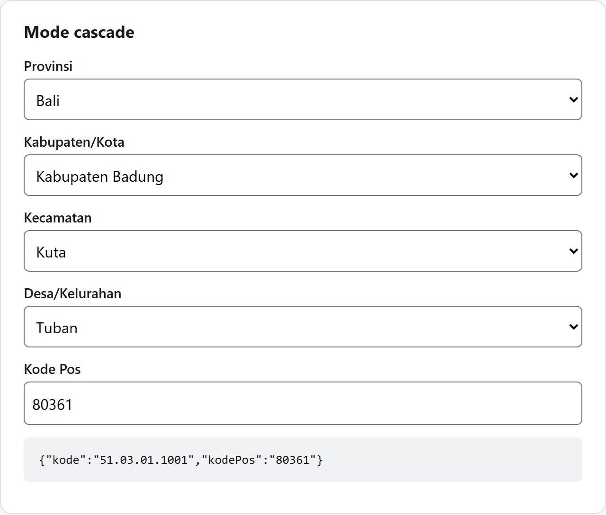
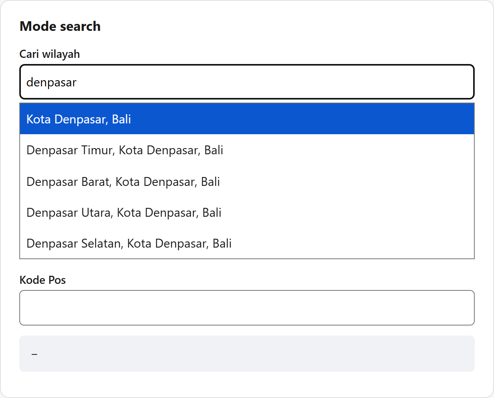

# nusawilayah

[](https://www.npmjs.com/package/@nusawilayah/react)
[](https://www.npmjs.com/package/@nusawilayah/core)
[](https://www.npmjs.com/package/@nusawilayah/data)
[](https://github.com/cuikww/nusawilayah/actions/workflows/ci.yml)
[](LICENSE)

**Indonesian region picker and region data.** Pick a provinsi → kabupaten/kota → kecamatan → desa/kelurahan and get its postal code, using the official **Kepmendagri No. 300.2.2-2430 Tahun 2025** data: 38 provinces, 514 regencies/cities, 7,285 districts and 83,762 villages.

- **Drop-in React component**: cascading dropdowns or a single search box, with postal code.
- **Tiny and fast**: about 6 KB gzipped of JavaScript. Data loads on demand from a CDN, under 1 KB per step.
- **Search without a server**: type `denpasar sel`, `seminyak kuta`, the postal code `80361`, or a former name.
- **Code changes handled**: `migrate()` maps addresses saved under the previous decree to the current codes.
- **Accessible**: native `<select>` and an ARIA 1.2 combobox, tested with axe (WCAG 2.1 AA) in a real browser.
- **Any stack**: a headless core for any framework, plus JSON, **SQLite** and **CSV** for PHP/Laravel, Flutter, Python, Java, Go, MySQL and PostgreSQL.
- **Verified data**: every release checks counts, unique codes, parents and postal codes before it is published, with npm provenance.

## Preview

| Cascade mode | Search mode |
| --- | --- |
|  |  |

Run it yourself: `pnpm install && pnpm build && pnpm --filter example-vite dev` (see [apps/example-vite](apps/example-vite)).

## Contents

- [Packages](#packages)
- [Quick start (React)](#quick-start-react)
- [What you get back](#what-you-get-back)
- [Component props](#component-props)
- [Recipes](#recipes): forms, edit forms, React Hook Form, English labels, custom UI, styling, self-hosting
- [Without React: `@nusawilayah/core`](#without-react-nusawilayahcore)
- [Other languages: JSON, SQLite, CSV](#other-languages-json-sqlite-csv)
- [Data, versions and sources](#data-versions-and-sources)
- [Development](#development)
- [License and attribution](#license-and-attribution)

## Packages

| Package | What it is | Size |
| --- | --- | --- |
| [`@nusawilayah/react`](packages/react) | `<WilayahPicker>` component and `useWilayah` hook | ~3 KB gzip |
| [`@nusawilayah/core`](packages/core) | Headless client: data loading, cache, search, cascade state. No dependencies | ~3.5 KB gzip |
| [`@nusawilayah/data`](packages/data) | The data: split JSON, a SQLite database and CSV files | loaded on demand |

The API uses the Indonesian names of the levels (`provinsi`, `kabupaten`, `kecamatan`, `desa`) because they are the official terms. See the [glossary](docs/SPEC.md#2-glossary).

## Quick start (React)

```sh
npm install @nusawilayah/react
```

```tsx
import { WilayahPicker } from '@nusawilayah/react'

export function AddressForm() {
  return <WilayahPicker onChange={(alamat) => console.log(alamat)} />
}
```

That's it: no data to download, no API key, no CSS to import. The data comes from jsDelivr as the user picks.

Prefer one search box? It accepts names and postal codes:

```tsx
<WilayahPicker mode="search" onChange={(alamat) => console.log(alamat)} />
```

| Query | First result |
| --- | --- |
| `denpasar sel` | Denpasar Selatan, Kota Denpasar, Bali |
| `seminyak kuta` | Seminyak, Kuta, Badung, Bali |
| `kota bogor` | Kota Bogor, Jawa Barat |
| `80361` | Tuban, Kuta, Badung, Bali (and the other 4 villages with that postal code) |
| `johan pahwalan` | Johan Pahlawan, Aceh Barat, Aceh (dulu Johan Pahwalan): former names are found too |

## What you get back

`onChange` receives an `Alamat` (address) with one entry per level. Picking Bali → Badung → Kuta → Tuban gives:

```json
{
  "provinsi":  { "kode": "51", "nama": "Bali", "level": "provinsi" },
  "kabupaten": { "kode": "51.03", "nama": "Kabupaten Badung", "level": "kabupaten", "induk": "51", "tipe": "kabupaten" },
  "kecamatan": { "kode": "51.03.01", "nama": "Kuta", "level": "kecamatan", "induk": "51.03" },
  "desa":      { "kode": "51.03.01.1001", "nama": "Tuban", "level": "desa", "induk": "51.03.01", "tipe": "kelurahan", "kodePos": ["80361"] },
  "kodePos": "80361"
}
```

| Field | Meaning |
| --- | --- |
| `kode` | Official Kemendagri code. Store this one: the deepest kode is enough to restore the whole address. |
| `nama` | Official name |
| `level` | `provinsi`, `kabupaten`, `kecamatan` or `desa` |
| `induk` | Parent kode |
| `tipe` | `kabupaten` or `kota` at level 2, `desa` or `kelurahan` at level 4 |
| `kodePos` | Postal code(s) of the desa; `alamat.kodePos` is the selected one |

**Tip:** save only `alamat.desa.kode` (e.g. `51.03.01.1001`) in your database. It contains the province, regency and district codes, and `defaultValue` restores the full picker from it.

## Component props

| Prop | Type | Default | Description |
| --- | --- | --- | --- |
| `mode` | `'cascade' \| 'search'` | `'cascade'` | One dropdown per level, or one search box |
| `levels` | `1 \| 2 \| 3 \| 4` | `4` | Deepest level: 1 = provinsi only ... 4 = desa |
| `onChange` | `(alamat: Alamat) => void` | | Called on every change |
| `defaultValue` | `string` | | Initial kode (uncontrolled), e.g. `'51.03.01.1001'` |
| `value` | `string \| Alamat \| null` | | Controlled value; `null` clears |
| `name` | `string` | | Adds hidden inputs `{name}` (deepest kode) and `{name}_kodepos` for plain HTML forms |
| `provinsi` | `string[]` | all | Restrict the provinces, e.g. `['51', '52']` |
| `required`, `disabled` | `boolean` | | As on native inputs |
| `placeholder` | `Partial<Record<Level, string>>` | | Placeholder per level |
| `labels` | `Partial<Labels>` | `labelsId` (Indonesian) | Every visible text; `labelsEn` for English |
| `components` | `{ Field?: ComponentType<FieldProps> }` | native `<select>` | Your own field component |
| `client` | `WilayahClient` | shared jsDelivr client | Self-hosted data or a custom fetcher |
| `className`, `id`, `onBlur`, `ref` | | | Passed to the wrapper, the inputs and the first input |

## Recipes

### Plain HTML form (Laravel, Rails, Django, server actions)

```tsx
<form method="post" action="/alamat">
  <WilayahPicker name="wilayah" required />
  <button>Save</button>
</form>
```

The server receives `wilayah=51.03.01.1001` and `wilayah_kodepos=80361`.

### Edit form

```tsx
<WilayahPicker defaultValue={user.kodeWilayah} onChange={setAlamat} />
```

The picker loads every level of the saved kode and pre-selects them.

### Controlled

```tsx
const [kode, setKode] = useState<string | null>('51.03.01.1001')

<WilayahPicker value={kode} onChange={(a) => setKode(a.desa?.kode ?? null)} />
<button onClick={() => setKode(null)}>Clear</button>
```

### React Hook Form

```tsx
import { Controller, useForm } from 'react-hook-form'

const { control, handleSubmit } = useForm<{ alamat: Alamat }>()

<Controller
  name="alamat"
  control={control}
  rules={{ validate: (a) => !!a?.desa || 'Choose a village' }}
  render={({ field }) => <WilayahPicker {...field} />}
/>
```

### English labels

```tsx
import { WilayahPicker, labelsEn } from '@nusawilayah/react'

<WilayahPicker labels={labelsEn} />                              // Province, Regency/City, District, Village
<WilayahPicker labels={{ ...labelsEn, desa: 'Village/Kelurahan' }} /> // override one label
```

### Only some levels or provinces

```tsx
<WilayahPicker levels={2} />                   // provinsi + kabupaten/kota only
<WilayahPicker provinsi={['31', '32', '36']} /> // Jakarta, West Java, Banten only
```

### Your own UI kit (shadcn/ui, MUI, Chakra, ...)

Replace the field component. It receives everything it needs as `FieldProps`:

```tsx
import { WilayahPicker, type FieldProps } from '@nusawilayah/react'

function MyField({ id, label, placeholder, options, value, onChange, disabled, loading, error, onRetry }: FieldProps) {
  return (
    <label htmlFor={id}>
      {label}
      <MySelect id={id} value={value} disabled={disabled} onValueChange={(v) => onChange(v || undefined)}>
        <MyOption value="">{loading ? 'Loading…' : placeholder}</MyOption>
        {options.map((o) => <MyOption key={o.kode} value={o.kode}>{o.nama}</MyOption>)}
      </MySelect>
      {error && <button onClick={onRetry}>Retry</button>}
    </label>
  )
}

<WilayahPicker components={{ Field: MyField }} />
```

Or skip the component and build everything with the headless hook:

```tsx
import { useWilayah } from '@nusawilayah/react'

const { levels, select, retry, alamat, kode } = useWilayah({ defaultValue: '51.03' })
// levels[i]: { level, options, selected, loading, error }
// select('kabupaten', '51.03') or select(1, '51.03')
```

### Styling

The components ship no CSS. Style them with `className` and these attributes:

| Selector | Element |
| --- | --- |
| `[data-nw-picker]` | Wrapper (`="cascade"` or `="search"`) |
| `[data-nw-field]` | One field (`="provinsi"`, ..., `="search"`, `="kodePos"`) |
| `[data-nw-error]` | Error message with a retry button |
| `[role="listbox"]`, `[role="option"]` | Search results |
| `[data-nw-active]` | Highlighted search result |
| `[data-nw-status]` | "Loading" / "No results" live region |

```css
[data-nw-field] { display: grid; gap: .25rem; margin-bottom: .75rem; }
[data-nw-picker] select, [data-nw-picker] input { min-height: 44px; border-radius: 6px; }
[data-nw-active] { background: #0b57d0; color: #fff; }
[data-nw-error] { color: #b3261e; }
```

### Self-hosting the data

By default the data comes from `https://cdn.jsdelivr.net/npm/@nusawilayah/data@2025.2/dist`. To serve it yourself (intranet, offline, strict CSP):

```sh
npm install @nusawilayah/data
cp -r node_modules/@nusawilayah/data/dist public/wilayah
```

```tsx
import { createWilayah } from '@nusawilayah/core'

const client = createWilayah({ baseUrl: '/wilayah' }) // create once, outside components
<WilayahPicker client={client} />
```

Next.js App Router: `WilayahPicker` is marked `"use client"`, so it can be used directly in a server component page.

## Without React: `@nusawilayah/core`

```sh
npm install @nusawilayah/core
```

```ts
import { createWilayah } from '@nusawilayah/core'

const w = createWilayah()

await w.provinsi()                // [{ kode: '11', nama: 'Aceh', level: 'provinsi' }, ...] (38)
await w.children('51')            // kabupaten/kota in Bali (9)
await w.children('51.03.01')      // desa in Kuta, each with kodePos
await w.resolve('51.03.01.1001')  // the full Alamat shown above
await w.byPostalCode('80361')     // Tuban, Kuta, Kedonganan, Legian, Seminyak
await w.search('denpasar sel')    // [{ wilayah: {...}, label: 'Denpasar Selatan, Kota Denpasar, Bali' }]
await w.search('kuta', { levels: 3, provinsi: ['51'], limit: 5 })
await w.migrate('72.01.09.2012')  // { status: 'moved', kode: '72.01.24.2007', namaLama: 'Tohitisari', alamat }
```

Results are cached in memory, failed loads can be retried, and invalid codes are rejected before any request.

### Cascade state for other frameworks (Vue, Svelte, Solid, vanilla)

`createCascade` holds the dropdown state, drops stale responses when the user switches quickly, and notifies subscribers. An adapter only renders it:

```ts
const cascade = w.createCascade({ levels: 4 })

cascade.subscribe((state) => render(state)) // state.levels[i]: { level, options, selected, loading, error }
await cascade.select('provinsi', '51')       // clears the levels below and loads the kabupaten
await cascade.setValue('51.03.01.1001')      // fills every level (edit forms)
cascade.retry('kabupaten')                   // after a network error
cascade.getState().alamat                    // the current Alamat
```

Vue 3 example:

```ts
import { createWilayah } from '@nusawilayah/core'
import { onUnmounted, shallowRef } from 'vue'

export function useWilayah() {
  const cascade = createWilayah().createCascade()
  const state = shallowRef(cascade.getState())
  onUnmounted(cascade.subscribe((s) => (state.value = s)))
  return { state, select: cascade.select }
}
```

### Migrating saved addresses

Kemendagri renumbers and renames regions between decrees. If you stored kode under the previous edition (Kepmendagri No. 100.1.1-6117 Tahun 2022), `migrate` tells you what happened to each one:

```ts
const m = await w.migrate(user.kodeWilayah)

switch (m.status) {
  case 'unchanged':
  case 'renamed':  // same kode, new name: m.namaLama is the old one
    break
  case 'moved':    // new kode, e.g. the village moved to a new kecamatan
    await db.users.update(user.id, { kodeWilayah: m.kode })
    break
  case 'removed':  // ask the user to pick their address again
  case 'unknown':
    await flagForReview(user.id)
}
```

| status | Meaning | Count since the previous edition |
| --- | --- | --- |
| `unchanged` | Same kode, same name | |
| `renamed` | Same kode, new name | 776 |
| `moved` | New kode (`m.kode`) | 90 |
| `removed` | The kode no longer exists | 1,160 |
| `unknown` | Not a kode of either edition | |

The same data is in `changes.json`, and in the `perubahan` table of the SQLite database for migrating in SQL. See [SPEC.md section 5](docs/SPEC.md#5-former-names-and-changes).

### Custom data source

```ts
createWilayah({ baseUrl: 'https://my.cdn.example/wilayah' })
createWilayah({ fetcher: (path) => myApi.get(`/wilayah/${path}`) }) // path e.g. 'kabupaten/51.json'
```

A custom fetcher must throw an error with `status: 404` for a file that does not exist.

## Other languages: JSON, SQLite, CSV

Every data release also ships a SQLite database and CSV files, built from the same validated data. The full format is in [docs/SPEC.md](docs/SPEC.md).

| File | Size | Use it for |
| --- | --- | --- |
| [`export/nusawilayah.sqlite`](https://cdn.jsdelivr.net/npm/@nusawilayah/data@2025.2/export/nusawilayah.sqlite) | 9.3 MB | Offline mobile/desktop apps: Flutter, Android, iOS, Python, PHP |
| [`export/csv/provinsi.csv`](https://cdn.jsdelivr.net/npm/@nusawilayah/data@2025.2/export/csv/provinsi.csv) ... [`desa.csv`](https://cdn.jsdelivr.net/npm/@nusawilayah/data@2025.2/export/csv/desa.csv) | 3.9 MB total | Importing into MySQL, PostgreSQL, spreadsheets |
| [`export/csv/alias.csv`](https://cdn.jsdelivr.net/npm/@nusawilayah/data@2025.2/export/csv/alias.csv), [`perubahan.csv`](https://cdn.jsdelivr.net/npm/@nusawilayah/data@2025.2/export/csv/perubahan.csv) | 0.2 MB | Former names; changes since the previous decree |
| `dist/**/*.json` | < 1 KB per file | Loading on demand from any HTTP client |

SQLite has a `wilayah` table, plus `alias` (former names) and `perubahan` (changes since the previous decree):

| kode | nama | level | induk | tipe | kode_pos |
| --- | --- | --- | --- | --- | --- |
| `51` | Bali | provinsi | | | |
| `51.03` | Kabupaten Badung | kabupaten | `51` | kabupaten | |
| `51.03.01` | Kuta | kecamatan | `51.03` | | |
| `51.03.01.1001` | Tuban | desa | `51.03.01` | kelurahan | `80361` |

```sh
curl -LO https://cdn.jsdelivr.net/npm/@nusawilayah/data@2025.2/export/nusawilayah.sqlite
sqlite3 nusawilayah.sqlite "SELECT kode, nama FROM wilayah WHERE induk = '51.03.01'"
```

**Python**

```python
import sqlite3

db = sqlite3.connect("nusawilayah.sqlite")
db.execute("SELECT kode, nama FROM wilayah WHERE induk = ? ORDER BY nama", ("51",)).fetchall()
db.execute("SELECT kode, nama FROM wilayah WHERE kode_pos = ?", ("80361",)).fetchall()
```

**PHP / Laravel** (import the CSV into MySQL, or point a connection at the SQLite file)

```sql
CREATE TABLE wilayah_desa (kode VARCHAR(13) PRIMARY KEY, induk VARCHAR(8), nama VARCHAR(100), tipe VARCHAR(9), kode_pos CHAR(5));
LOAD DATA LOCAL INFILE 'desa.csv' INTO TABLE wilayah_desa
  FIELDS TERMINATED BY ',' OPTIONALLY ENCLOSED BY '"' LINES TERMINATED BY '\n' IGNORE 1 LINES;
```

```php
// config/database.php: 'wilayah' => ['driver' => 'sqlite', 'database' => storage_path('nusawilayah.sqlite')]
$kabupaten = DB::connection('wilayah')->table('wilayah')->where('induk', '51')->orderBy('nama')->get();
```

**PostgreSQL**

```sql
CREATE TABLE wilayah_desa (kode text PRIMARY KEY, induk text, nama text, tipe text, kode_pos text);
\copy wilayah_desa FROM 'desa.csv' WITH (FORMAT csv, HEADER true)
```

**Flutter** (with [`sqflite`](https://pub.dev/packages/sqflite): copy the file from your assets to the databases folder on first launch)

```dart
final db = await openDatabase(path, readOnly: true);
final kabupaten = await db.query('wilayah', where: 'induk = ?', whereArgs: ['51'], orderBy: 'nama');
```

**Any language, JSON over HTTP**

```sh
curl https://cdn.jsdelivr.net/npm/@nusawilayah/data@2025.2/dist/kabupaten/51.json
# [["51.01","Kabupaten Jembrana"],["51.02","Kabupaten Tabanan"],["51.03","Kabupaten Badung"], ...]
```

Treat `kode` as text everywhere: `51.10` is not the number `51.1`.

## Data, versions and sources

- **Legal basis:** Kepmendagri No. 300.2.2-2430 Tahun 2025, the current decree on region codes and names.
- **Sources:** [cahyadsn/wilayah](https://github.com/cahyadsn/wilayah) and [cahyadsn/wilayah_kodepos](https://github.com/cahyadsn/wilayah_kodepos), pinned per commit in [pipeline/build.ts](pipeline/build.ts) so every build is reproducible.
- **Checks before release:** exact counts per level (38 / 514 / 7,285 / 83,762), unique and well-formed codes, no orphans, a valid postal code for every desa. The build fails otherwise.
- **Data versions** are `YEAR.REVISION.PATCH` (`2025.2.x` = the second 2025 decree). A patch never changes a kode or nama, so the CDN URL `@2025.2` is safe to follow. Code packages use normal semver.
- **Former names and changes** come from comparing older editions in the same source, per kode ([SPEC.md section 5](docs/SPEC.md#5-former-names-and-changes)).
- **Postal codes** are best-effort and may be wrong for some villages. Let users correct them.

Technical decisions are recorded in [docs/DECISIONS.md](docs/DECISIONS.md).

## Development

Requires Node 24+ (the data pipeline runs TypeScript directly) and pnpm.

```sh
pnpm install
pnpm build                          # core, react, and the data pipeline (fails if validation fails)
pnpm test                           # unit tests (vitest)
pnpm typecheck
pnpm --filter example-vite dev      # demo at http://localhost:5173, self-hosted data
pnpm --filter example-vite e2e      # Playwright + axe in Chrome
PREVIEW=1 pnpm --filter example-vite e2e preview   # regenerate docs/images
```

```
packages/core      headless client (wilayah.ts domain rules, loader.ts, search.ts, cascade.ts, migrate.ts)
packages/react     WilayahPicker, useWilayah, DefaultField, SearchField
packages/data      generated data (dist/ JSON, export/ SQLite + CSV)
pipeline           download → validate → split → write; history.ts aliases + changes; export.ts SQLite + CSV
apps/example-vite  demo and browser tests
docs               SPEC.md (data format), DECISIONS.md (why things are the way they are)
```

### Releasing

Releases use [Changesets](https://github.com/changesets/changesets):

1. Add a changeset to your PR: `pnpm changeset`.
2. After merge, the Release workflow opens a "chore: version packages" PR.
3. Merging that PR publishes to npm through **npm Trusted Publishing** (GitHub OIDC, with provenance). No npm token is stored anywhere.

### Contributing

Issues and pull requests are welcome. Please run `pnpm build && pnpm test && pnpm typecheck` before opening a PR, and add a changeset if a published package changes. Ports to other languages should follow [docs/SPEC.md](docs/SPEC.md).

## License and attribution

Code: [MIT](LICENSE). Data: MIT, derived from [cahyadsn/wilayah](https://github.com/cahyadsn/wilayah) and [cahyadsn/wilayah_kodepos](https://github.com/cahyadsn/wilayah_kodepos) (MIT, © cahya dsn). Region codes and names come from Kepmendagri No. 300.2.2-2430 Tahun 2025.
