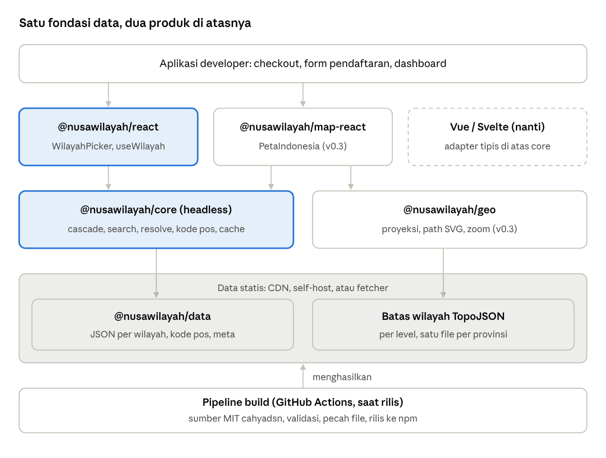
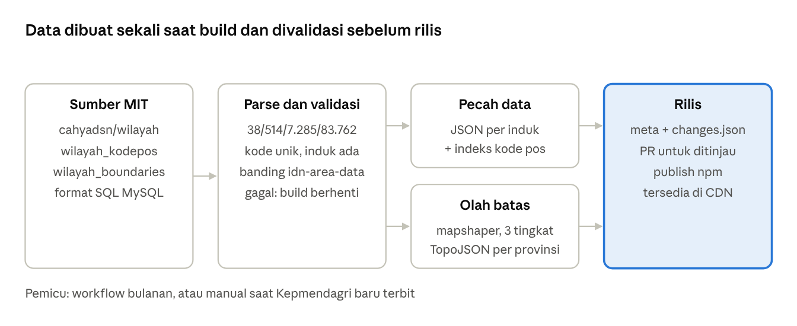
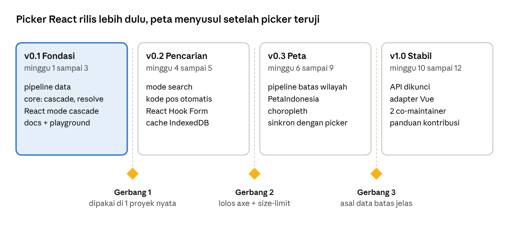

# PRD Nusa Wilayah: Region Picker & Peta Indonesia

Nov 2, 2026 · @kyky

> Dikonversi dari `PRD Nusa Wilayah Region Picker & Peta Indonesia.docx`. Isi asli tidak diubah; yang ditambahkan hanya penanda status implementasi dan catatan *Status:* bila implementasi berbeda dari rencana. Keputusan teknis lengkap ada di [DECISIONS.md](DECISIONS.md), format data di [SPEC.md](SPEC.md).

## Status implementasi

Per 3 November 2026: `@nusawilayah/core` 0.4.0, `@nusawilayah/react` 0.4.0, `@nusawilayah/data` 2025.2.4 terbit di npm (Trusted Publishing + provenance). Situs docs + playground: https://cuikww.github.io/nusawilayah/

Legenda: `[x]` selesai · `[ ]` belum · 🟡 sebagian (penjelasan di catatan)

| Fase | Status |
| --- | --- |
| v0.1 Fondasi | Selesai. **Gerbang 1** (dipakai di 1 proyek nyata) masih menunggu pemilik proyek |
| v0.2 Pencarian | Selesai, **Gerbang 2** lolos (axe + size-limit di CI) |
| v0.3 Peta | Selesai, **siap rilis**: Gerbang 3 lolos dengan sumber batas baru, BPS via HDX (CC BY 3.0 IGO). Menunggu terbitan pertama manual ke npm |
| v1.0 Stabil | Belum dimulai |

**Berikutnya:**

1. Gerbang 1: pakai picker di 1 proyek nyata
2. Rilis paket peta: terbitkan pertama kali secara manual, lalu pasang Trusted Publishing untuk ketiga paket
3. v1.0: kunci API, adapter Vue, 2 co-maintainer, CONTRIBUTING.md

**Di luar fase, belum dikerjakan:** lint dan Storybook di CI, skor Lighthouse, .zip di GitHub Releases, adapter sumber data kedua.

## Ringkasan

Nusa Wilayah adalah keluarga paket open source untuk memilih wilayah Indonesia lewat dropdown atau klik peta, memakai data resmi Kepmendagri No. 300.2.2-2430 Tahun 2025 (38 provinsi, 514 kabupaten/kota, 7.285 kecamatan, 83.762 desa/kelurahan).

Masalahnya: hampir semua form alamat di aplikasi Indonesia butuh pilihan wilayah bertingkat, tetapi belum ada komponen siap pakai di npm. Developer membangunnya sendiri berulang kali, sering dengan data usang (34 provinsi) yang membuat halaman berat.

Solusinya ada dua produk dari satu fondasi data:

- **Region picker:** komponen dropdown bertingkat provinsi sampai desa, dengan pencarian, kode pos otomatis, dan data yang dimuat sesuai kebutuhan.
- **Peta Indonesia:** peta SVG interaktif 38 provinsi sampai kecamatan, memakai kode Kemendagri yang sama sehingga terhubung langsung dengan picker.

Rilis pertama (v0.1) fokus pada region picker untuk React. Peta menyusul setelah picker stabil.

## Latar belakang

Riset npm per 2 November 2026 menemukan data wilayah yang akurat sudah tersedia, tetapi lapisan antarmuka (UI) belum ada, dan paket lama yang usang masih banyak diunduh.

| Temuan | Bukti | Dampak ke produk |
| --- | --- | --- |
| Data resmi terbaru sudah tersedia | idn-area-data cocok dengan Kepmendagri 2025 sampai kode desa (6.529 unduhan/bulan, aktif dirawat) | Data tidak perlu dikumpulkan sendiri; dipakai sebagai pembanding karena datanya ODbL (lihat Lisensi) |
| Paket wilayah lama masih 34 provinsi | geografis (577/bulan), daftar-wilayah-indonesia (382/bulan) | Pengguna di 4 provinsi Papua baru tidak bisa memilih wilayahnya |
| Peta SVG Indonesia hanya 34 provinsi | @svg-maps/indonesia (539/bulan), ID bukan kode Kemendagri | Peta tidak bisa disambungkan ke data wilayah |
| Batas wilayah lengkap ada, tapi format SQL | cahyadsn/wilayah_boundaries sampai desa, Kepmendagri 2025 | Bahan baku peta tersedia, perlu dikonversi |
| Tidak ada komponen picker | Pencarian npm "react wilayah indonesia select", "vue wilayah indonesia", "address picker" tanpa hasil yang relevan | Celah utama yang diisi produk ini |

Paket serba ada seperti @lokal-id/core dan nusaindex sudah menyediakan validasi NIK, kode pos, dan wilayah. Produk ini tidak menyaingi mereka, melainkan menjadi lapisan UI di atasnya.

## Tujuan, non-tujuan, dan metrik

Tujuan utama: developer bisa memasang form alamat Indonesia yang lengkap dan cepat dalam kurang dari 5 menit, dengan satu npm install.

**Tujuan**

- [x] Komponen picker bertingkat provinsi, kabupaten/kota, kecamatan, desa/kelurahan, plus kode pos
- [x] Pencarian langsung ("kuta" langsung menyarankan Kuta, Badung, Bali)
- [x] Ringan: memuat data hanya untuk level yang sedang dibuka
- [x] Data selalu mengikuti Kepmendagri terbaru, dengan versi data yang jelas
- [x] Peta interaktif 38 provinsi sampai kecamatan dengan kode yang sama — *Status:* selesai, siap rilis (sumber batas BPS via HDX)
- [x] Inti headless, sehingga bisa dipakai di React, Vue, Svelte, atau vanilla JS — *Status:* core + adapter React; contoh Vue ada di README, adapter Vue resmi dijadwalkan v1.0

**Non-tujuan**

- Bukan validator NIK/NPWP atau alat format Rupiah (sudah ditangani @lokal-id/core dan nusaindex)
- Bukan layanan geocoding, rute, atau ongkos kirim
- Bukan pengganti Google Maps atau peta jalan; peta hanya batas administratif
- Tidak menjamin keakuratan hukum batas wilayah (lihat bagian Lisensi); tidak mendukung level dusun/RT/RW

**Metrik keberhasilan (target 6 bulan setelah v1.0)**

| Metrik | Target | Status |
| --- | --- | --- |
| Unduhan npm paket React | 2.000/bulan | Diukur setelah v1.0 |
| Ukuran awal yang dimuat (picker, gzip) | di bawah 15 KB kode + 2 KB data provinsi | ✅ 5,3 KB kode (diukur size-limit di CI) + 0,4 KB provinsi |
| Waktu sampai dropdown provinsi tampil | di bawah 100 ms di HP kelas menengah | 🟡 diukur pada simulasi HP kelas menengah (CPU 4x lebih lambat, 4G 150 ms): dengan render server, provinsi sudah ada saat first paint (0,6 s sejak navigasi, dibatasi jaringan); dropdown berikutnya 24 ms dari cache, 0,4 s lewat jaringan |
| Jeda pembaruan data setelah Kepmendagri baru terbit | maksimal 30 hari | 🟡 workflow bulanan (`data-update.yml`) membuka PR paling lambat ±31 hari setelah sumber berubah; jeda dari terbitnya Kepmendagri sampai sumber diperbarui ada di luar kendali proyek |
| Kontributor selain pemilik proyek | minimal 3 | 🟡 1 (kykyramadhani) |
| Skor aksesibilitas (Lighthouse, halaman demo) | 100 | 🟡 axe WCAG 2.1 AA 0 pelanggaran; Lighthouse belum dijalankan |

## Pengguna sasaran & user stories

Pengguna utama adalah developer web Indonesia yang membuat form alamat; pengguna akhirnya adalah pembeli atau pendaftar yang mengisi form itu.

| Persona | Konteks | Kebutuhan utama |
| --- | --- | --- |
| Developer e-commerce | Checkout toko online, Next.js/React | Picker cepat, kode pos otomatis, hasil siap disimpan ke database |
| Freelancer / agensi web | Website UMKM, company profile, form pendaftaran | Pasang cepat, mudah diganti gayanya, tanpa backend |
| Vibecoder | Membangun app dengan bantuan AI | API sederhana, dokumentasi jelas yang bisa dibaca AI |
| Developer dashboard / data | Visualisasi data per daerah | Peta per provinsi/kabupaten yang bisa diwarnai dari data sendiri |
| Pembeli (pengguna akhir) | Mengisi alamat di HP | Cepat ketemu wilayahnya tanpa scroll ratusan pilihan |

**User stories**

- [x] Sebagai developer, saya memasang `<WilayahPicker />` dan langsung mendapat 4 dropdown bertingkat yang berfungsi.
- [x] Sebagai developer, saya menerima hasil berupa kode dan nama wilayah plus kode pos, siap disimpan.
- [x] Sebagai developer, saya bisa memuat ulang alamat tersimpan (dari kode desa) ke dalam picker untuk form edit.
- [x] Sebagai developer, saya menyambungkan picker ke React Hook Form atau Formik tanpa kode tambahan yang rumit. — *Status:* resep keduanya di README
- [x] Sebagai developer, saya mengganti tampilan dengan class Tailwind atau komponen UI saya sendiri (shadcn/ui, MUI).
- [x] Sebagai pembeli, saya mengetik "denpasar sel" dan langsung memilih Kecamatan Denpasar Selatan.
- [x] Sebagai pembeli, saya mengisi kode pos dan wilayahnya terisi otomatis (atau saya memilih jika satu kode pos mencakup beberapa desa). — *Status:* lewat kolom pencarian (`mode="search"`)
- [x] Sebagai developer dashboard, saya menampilkan peta kabupaten di Bali dan mewarnainya sesuai data penjualan. — *Status:* `<PetaIndonesia data>` (belum dirilis)
- [x] Sebagai pengguna peta, saya mengklik sebuah kabupaten dan picker ikut terisi. — *Status:* `apps/example-map` (belum dirilis)
- [x] Sebagai developer, saya menyimpan data di server sendiri (tanpa CDN) untuk aplikasi internal atau offline.

## Lingkup & kebutuhan fungsional

Produk terdiri dari 5 paket dalam satu monorepo; v0.1 hanya merilis tiga paket pertama.

| Paket | Isi | Rilis | Status |
| --- | --- | --- | --- |
| @nusawilayah/data | Data wilayah + kode pos, dipecah per wilayah dalam JSON | v0.1 | ✅ terbit (2025.2.4) |
| @nusawilayah/core | Logika headless: memuat data, cache, pencarian, state bertingkat | v0.1 | ✅ terbit (0.4.0) |
| @nusawilayah/react | Komponen `<WilayahPicker>`, hook `useWilayah` | v0.1 | ✅ terbit (0.4.0) |
| @nusawilayah/geo | Proyeksi dan render peta; data batas di paket terpisah per level (`geo-provinsi`, `geo-kabupaten`, `geo-kecamatan`) | v0.3 | 🟡 selesai, siap rilis; data batas dalam satu paket `@nusawilayah/geo-data` (CC BY 3.0 IGO) |
| @nusawilayah/map-react | Komponen `<PetaIndonesia>` | v0.3 | 🟡 selesai, siap rilis |

### F1. Data (@nusawilayah/data)

- [x] F1.1 Empat level: provinsi (38), kabupaten/kota (514), kecamatan (7.285), desa/kelurahan (83.762)
- [x] F1.2 Tiap wilayah punya kode Kemendagri bertitik (mis. 51.03.01.1001), nama resmi, tipe (kabupaten/kota, desa/kelurahan), dan nama lama jika pernah berganti (alias, mulai v0.2) — *Status:* nama lama ada di indeks pencarian, tabel SQLite `alias`, dan `alias.csv` (data 2025.2.4)
- [x] F1.3 Kode pos per desa/kelurahan, dan indeks balik kode pos ke daftar desa
- [x] F1.4 File meta.json mencatat dasar hukum (nomor Kepmendagri), tanggal build, dan jumlah per level
- [x] F1.5 Data dipecah: satu file provinsi, satu file kabupaten per provinsi, satu file kecamatan per kabupaten, satu file desa per kecamatan

### F2. Core (@nusawilayah/core)

- [x] F2.1 `createWilayah({ baseUrl })`: membuat klien dengan sumber data CDN, folder lokal, atau fungsi fetch sendiri
- [x] F2.2 Memuat anak wilayah sesuai pilihan (`children("51.03")`), dengan cache memori dan opsi cache IndexedDB — *Status:* `createWilayah({ cache: 'indexeddb' })`, simpan 7 hari, diuji offline di Chrome
- [x] F2.3 State machine bertingkat: memilih level atas mengosongkan level di bawahnya
- [x] F2.4 `resolve("51.03.01.1001")`: mengisi semua level dari satu kode, untuk form edit
- [x] F2.5 Pencarian: cocok awalan dan tanpa memperhatikan huruf besar, mengabaikan kata "Kabupaten", "Kota", "Kecamatan"; nama lama ikut dicari; seluruhnya di browser tanpa server; hasil menampilkan jalur lengkap ("Kuta, Badung, Bali") — *Status:* kata "Kota" sengaja **tidak** diabaikan agar Kota Bogor dan Kabupaten Bogor bisa dibedakan; nama lama ikut dicari (core 0.4.0)
- [x] F2.6 Lookup kode pos: `byPostalCode("80361")` mengembalikan daftar desa
- [x] F2.7 Bisa membatasi cakupan, mis. hanya provinsi tertentu atau berhenti di level kecamatan

### F3. Komponen React (@nusawilayah/react)

- [x] F3.1 `<WilayahPicker>` dengan mode cascade (4 dropdown) dan mode search (satu kolom pencarian)
- [x] F3.2 Props: value, defaultValue, onChange, levels (sampai level mana), required, disabled, placeholder per level
- [x] F3.3 Kode pos otomatis terisi; jika satu kode pos mencakup beberapa desa, pengguna diminta memilih
- [x] F3.4 Kompatibel dengan React Hook Form (Controller) dan form HTML biasa (hidden input bernama)
- [x] F3.5 Tanpa gaya bawaan yang memaksa: mode unstyled + slot/render prop untuk memakai komponen UI sendiri; tema default opsional — *Status:* tema opsional `@nusawilayah/react/style.css` dengan variabel CSS `--nw-*`
- [x] F3.6 Status loading, error, dan coba lagi per dropdown
- [x] F3.7 Label dalam Bahasa Indonesia secara default, bisa diganti (mis. Inggris)
- [x] F3.8 Mendukung React Server Components: komponen ditandai "use client", data provinsi bisa di-render dari server — *Status:* prop `initialProvinsi`; diuji di `apps/example-next` (build produksi)

### F4. Peta (@nusawilayah/geo, @nusawilayah/map-react)

- [x] F4.1 Batas wilayah 38 provinsi, 514 kabupaten/kota, dan kecamatan, per file provinsi — *Status:* `@nusawilayah/geo-data` dari batas BPS 2020 (HDX); semua 38 provinsi dan 514 kabupaten/kota, 95,9% kecamatan (pemekaran setelah 2020 belum punya batas sendiri)
- [x] F4.2 Tiga tingkat kehalusan garis (kasar untuk seluruh Indonesia, sedang untuk provinsi, halus untuk kabupaten) — *Status:* toleransi 1 km / 300 m / 200 m
- [x] F4.3 `<PetaIndonesia level="kabupaten" provinsi="51" />`: render SVG, hover, klik, zoom ke wilayah — *Status:* plus keyboard (Enter/Space) dan `zoomTo`
- [x] F4.4 Mewarnai wilayah dari data sendiri (choropleth) lewat prop data dan colorScale — *Status:* dengan legenda
- [x] F4.5 Sinkron dua arah dengan `<WilayahPicker>` lewat kode Kemendagri yang sama — *Status:* diuji di `apps/example-map`
- [x] F4.6 Ekspor SVG statis (tanpa React) untuk dipakai di desain atau situs non-React — *Status:* file `.svg` per level per provinsi, dan `@nusawilayah/geo` untuk framework lain

Peta berdiri sendiri. Paket peta tidak bergantung pada picker maupun React; keduanya hanya berbagi kode wilayah Kemendagri (mis. 51.03 = Badung). Cara pakai tanpa picker:

- [x] F4.7 File SVG statis per wilayah (mis. bali-kabupaten.svg) untuk ``, Figma, atau presentasi — *Status:* nama file `kabupaten/51.svg`
- [x] F4.8 SVG inline di HTML biasa (PHP, Laravel, WordPress); tiap wilayah punya id berbasis kode (kab-51-03) sehingga bisa diwarnai dengan CSS — *Status:* `prov-51`, `kab-51-03`, `kec-51-03-01`
- [x] F4.9 GeoJSON/TopoJSON yang langsung terbaca Leaflet, MapLibre, D3, ECharts, dan Highcharts untuk dashboard per wilayah
- [x] F4.10 Sinkron dengan `<WilayahPicker>` hanya opsional, untuk yang ingin klik peta mengisi form — *Status:* map-react hanya bergantung pada geo, tidak pada picker

### F5. Dukungan bahasa & platform lain

Data dan file peta berupa file biasa sehingga bisa dibaca bahasa apa pun; yang khusus JavaScript/React hanya komponen dropdown dan peta interaktifnya.

- [x] F5.1 Setiap rilis data juga menghasilkan SQLite (satu file .db berisi wilayah + kode pos) untuk aplikasi desktop dan mobile offline (Java, C#, Python, Flutter, PHP) — *Status:* `export/nusawilayah.sqlite`
- [x] F5.2 Setiap rilis juga menghasilkan CSV per level untuk diimpor ke MySQL/PostgreSQL — *Status:* `export/csv/*.csv`
- [x] F5.3 Dokumen spesifikasi data (SPEC.md): tata letak file, skema JSON, skema SQLite, format kode, dan aturan versi, supaya port buatan komunitas tetap konsisten — *Status:* [SPEC.md](SPEC.md)
- [ ] F5.4 Port resmi setelah v1.0, diutamakan dikerjakan kontributor: PHP/Laravel lebih dulu (ekosistem terbesar di Indonesia), lalu Flutter

| Platform | Cara pakai |
| --- | --- |
| Electron, Tauri | Paket JS/React langsung, tanpa perubahan |
| Node.js, skrip, CLI | @nusawilayah/core langsung |
| React Native | core jalan; peta memakai react-native-svg |
| Flutter (mobile/desktop) | Baca JSON atau SQLite, SVG dengan flutter_svg |
| Java (JavaFX, Swing), C# (.NET) | Baca SQLite atau JSON, dropdown dibuat dengan UI masing-masing |
| PHP / Laravel | Impor CSV ke database atau baca JSON; SVG langsung di template Blade |
| Python (Qt, Tkinter, data science) | GeoJSON lewat GeoPandas, atau SQLite |

Riset singkat: data wilayah sudah banyak tersedia di PHP, Python (py-nusantara), dan Flutter, tetapi peta wilayah gratis yang mutakhir belum ditemukan; peta SVG 38 provinsi justru dijual berbayar (kulikode-dev).

## Kebutuhan non-fungsional

Batasan terpenting adalah ukuran: 83.762 desa tidak boleh pernah dimuat sekaligus di browser.

| Area | Kebutuhan | Target | Status |
| --- | --- | --- | --- |
| Ukuran kode | core + react digabung, gzip | di bawah 15 KB | ✅ 5,3 KB, dijaga size-limit di CI |
| Ukuran data per langkah | Satu file anak wilayah, gzip | di bawah 1 KB (terukur 0,2 KB rata-rata, lihat Pipeline data) | ✅ rata-rata 0,2 KB, terbesar 0,85 KB |
| Indeks pencarian | Dimuat hanya saat mode search dipakai: indeks nasional sampai kecamatan + indeks desa per provinsi | nasional 57 KB; desa per provinsi rata-rata 17 KB, terbesar 62 KB (gzip, terukur) | ✅ nasional 57 KB; desa rata-rata 16 KB, terbesar 60 KB |
| Peta | Peta seluruh Indonesia, level provinsi, gzip | di bawah 150 KB | ✅ 53 KB TopoJSON; build gagal bila melewati batas |
| Performa | Dropdown berikutnya terisi setelah memilih (data sudah di cache) | di bawah 50 ms | ✅ 24 ms dengan CPU 4x lebih lambat |
| Aksesibilitas | WCAG 2.1 AA: navigasi keyboard penuh, pola ARIA combobox, label terbaca screen reader | wajib | ✅ axe 0 pelanggaran di Chrome |
| Mobile | Area sentuh minimal 44 px, bisa memakai `<select>` native di HP | wajib | ✅ `<select>` native; tema opsional memakai area sentuh 44 px |
| Kompatibilitas | React 18 dan 19, Next.js App Router dan Pages Router, Vite | wajib | ✅ diuji di CI: React 18 dan 19, Vite, Next.js App Router dan Pages Router (`apps/example-next/pages`) |
| Modul | ESM + CJS, tree-shakeable, tipe TypeScript disertakan | wajib | ✅ |
| Dependensi | core tanpa dependensi; react hanya peer dependency React | wajib | ✅ |
| Bahasa | Indonesia default, Inggris tersedia | wajib | ✅ `labelsEn` |
| Offline | Bisa jalan tanpa internet jika data di-self-host | wajib | ✅ `baseUrl` / `fetcher` |

Ukuran data sudah diukur dari data asli; target ukuran kode dan peta masih perkiraan dan dikunci setelah prototipe.

## Arsitektur sistem

Semua paket hidup di satu monorepo (pnpm workspace + Turborepo); hanya core yang berisi logika, lapisan UI di atasnya tipis, dan data tidak pernah masuk bundle kode.



Panah turun berarti "memakai". Aplikasi hanya memasang paket UI; paket UI memakai core atau geo; keduanya memuat file data statis saat dibutuhkan. Data dibuat sekali oleh pipeline build, bukan di browser.

**Struktur monorepo**

```
nusawilayah/
  packages/
    core/        logika headless, tanpa dependensi
    react/       komponen + hook
    data/        hasil build JSON (tidak ditulis tangan)
    geo/         proyeksi + hasil build TopoJSON
    map-react/   komponen peta
  pipeline/      skrip ambil sumber, validasi, pecah file
  apps/
    docs/        situs dokumentasi + playground
    example-next/  contoh Next.js (uji e2e)
```

*Status:* `core`, `react`, `data`, `pipeline`, `apps/docs` (docs + playground, GitHub Pages) dan `apps/example-next` ada, ditambah `apps/example-vite` (demo minimal + uji e2e). `geo` dan `map-react` menunggu v0.3.

**Alur saat pengguna memilih wilayah**

1. Halaman dibuka: komponen memuat provinsi.json (sekitar 2 KB), atau sudah di-render dari server.
2. Pengguna memilih Bali: core memuat kabupaten/51.json, menyimpannya di cache, dropdown kabupaten terisi.
3. Pengguna memilih Badung, lalu Kuta: file kecamatan dan desa dimuat dengan cara yang sama.
4. Pengguna memilih Tuban: kode pos 80361 terisi dari data desa, onChange mengirim objek Alamat lengkap.
5. Kunjungan berikutnya: file yang sama diambil dari cache, tanpa jaringan.

*Status:* semua langkah berjalan. provinsi.json terukur 0,4 KB atau di-render dari server (`initialProvinsi`); kunjungan berikutnya memakai cache IndexedDB (`cache: 'indexeddb'`).

## Pipeline data

Data dipecah per wilayah induk sehingga setiap langkah memilih hanya memuat file di bawah 1 KB (gzip); angka di bawah diukur dari data Kepmendagri 2025 yang sebenarnya.



Pipeline ditulis dalam TypeScript (Node), membaca SQL sumber, memvalidasi, lalu menulis file. Jika satu cek gagal, tidak ada yang dirilis.

**Tata letak file data**

```
dist/
  meta.json                 dasar hukum, tanggal build, jumlah per level
  provinsi.json             38 provinsi
  kabupaten/51.json         kabupaten/kota di Bali
  kecamatan/51.03.json      kecamatan di Badung
  desa/51.03.01.json        desa/kelurahan di Kuta + kode pos
  kodepos/80.json           indeks kode pos berawalan 80
  search/nasional.json      indeks provinsi sampai kecamatan (57 KB)
  search/51.json            indeks desa Bali
  changes.json              perubahan dibanding rilis sebelumnya
```

*Status:* semua file di atas sudah dibuat. Tambahan di luar rencana: `export/nusawilayah.sqlite` dan `export/csv/*.csv`.

**Ukuran hasil (diukur, kode + nama saja, gzip)**

| File | Jumlah file | Rata-rata | Terbesar |
| --- | --- | --- | --- |
| provinsi.json | 1 | 0,4 KB | 0,4 KB |
| kabupaten/*.json | 38 | 0,2 KB | 0,4 KB |
| kecamatan/*.json | 514 | 0,2 KB | 0,4 KB |
| desa/*.json | 7.285 | 0,2 KB | 0,8 KB |
| search/*.json (per provinsi) | 38 | 17 KB | 62 KB |
| Seluruh indeks dalam satu file (tidak dipakai) | 1 | 650 KB | 650 KB |

Kode pos akan menambah ukuran file desa sedikit. Indeks lengkap sampai desa berukuran 650 KB, jadi tidak dimuat sekaligus; pencarian lintas Indonesia memakai indeks nasional provinsi sampai kecamatan (7.837 entri, 57 KB gzip, terukur), lalu indeks desa provinsi yang relevan dimuat saat diperlukan. Tidak perlu server API.

### Sumber data cahyadsn

Ketiga sumber utama berasal dari Cahya DSN (cahyadsn), semuanya MIT, dan satu-satunya sumber yang ditemukan dengan batas wilayah sampai desa yang memakai kode Kemendagri.

| Repo | Isi | Format | Ukuran |
| --- | --- | --- | --- |
| wilayah | Kode dan nama wilayah, Kepmendagri 300.2.2-2430/2025 | SQL | 91.599 baris |
| wilayah_kodepos | Kode pos per desa | SQL | 83.762 desa |
| wilayah_boundaries | Batas wilayah (multipolygon, sudah disederhanakan) | SQL, satu file per provinsi per level | kabupaten 6,6 MB · kecamatan 12,2 MB · desa 187 MB. **Tidak dipakai**: asal poligonnya campuran, termasuk tracing Google Maps (jawaban #9), diganti batas BPS via HDX |

Repo lain miliknya (wilayah_logo, wilayah_api, wilayah_ref) tidak dipakai.

Nama lama (alias) dibentuk dengan membandingkan arsip di repo wilayah (db/archive, Kepmendagri 2022 dan 2023) dengan data terbaru, per kode wilayah. *Status:* selesai, memakai `wilayah_2022.sql` dan `wilayah_2023.sql`.

Alternatif yang ditolak: GADM (lisensinya melarang pemakaian komersial), OpenStreetMap (ODbL, wajib share-alike), dan idn-area-data (data ODbL, tanpa batas wilayah).

Kondisi data batas mentah (diperiksa langsung pada file Bali):

- Berupa perintah SQL INSERT dengan kolom kode, nama, lat, lng (titik tengah), dan path berisi koordinat sebagai teks
- Urutan koordinat lintang dulu [lat, lng], sedangkan GeoJSON memakai bujur dulu [lng, lat]; pipeline wajib menukarnya
- Tidak ada file batas level provinsi; batas provinsi dibentuk dengan menggabungkan kabupaten/kota di dalamnya (mapshaper -dissolve) — *Status:* sudah tidak berlaku: repo kini punya `db/prov/` (8 file), dan itu yang dipakai
- Asal batasnya (BIG, OSM, atau olahan sendiri) belum tertulis di repo dan perlu dikonfirmasi ke pemiliknya

Pengolahan peta: parse SQL, tukar urutan koordinat, gabungkan kabupaten menjadi provinsi, sederhanakan dengan mapshaper ke tiga tingkat kehalusan, lalu simpan sebagai TopoJSON (garis batas bersama disimpan sekali), GeoJSON, dan SVG, satu file per provinsi per level. *Status:* selesai (v0.3), dengan sumber BPS via HDX: kecamatan dipasangkan ke kode Kemendagri lewat nama, provinsi digabung dari kabupaten.

## Desain API publik

API dibangun berlapis: tipe data dan klien headless di core, lalu hook dan komponen tipis di react, supaya port ke Vue atau Svelte hanya menulis ulang lapisan tipis.

### Tipe data

```ts
type Level = 'provinsi' | 'kabupaten' | 'kecamatan' | 'desa'

interface Wilayah {
  kode: string          // '51.03.01.1001'
  nama: string          // 'Tuban'
  level: Level
  tipe?: 'kabupaten' | 'kota' | 'desa' | 'kelurahan'
  induk?: string        // kode wilayah di atasnya
  kodePos?: string[]    // hanya level desa
}

interface Alamat {
  provinsi?: Wilayah
  kabupaten?: Wilayah
  kecamatan?: Wilayah
  desa?: Wilayah
  kodePos?: string
}
```

*Status:* diimplementasikan persis seperti di atas.

### Core (headless)

```ts
import { createWilayah } from '@nusawilayah/core'

const w = createWilayah({
  baseUrl: 'https://cdn.jsdelivr.net/npm/@nusawilayah/data@2025.2/dist',
  cache: 'indexeddb',          // atau 'memory'
})

await w.provinsi()                 // Wilayah[] (38)
await w.children('51.03')          // kecamatan di Badung
await w.resolve('51.03.01.1001')   // Alamat lengkap untuk form edit
await w.search('kuta', { limit: 10 })
await w.byPostalCode('80361')      // Wilayah[] level desa

const picker = w.createCascade({ levels: 4 })
picker.select('provinsi', '51')    // mengosongkan level di bawahnya
picker.subscribe(state => { /* untuk adapter framework */ })
```

*Status:* semua ada. Tambahan: `fetcher`, `migrate(kode)`, `cascade.setValue/setKodePos/retry`, `createCascade({ initialProvinsi })`.

### React

```tsx
import { WilayahPicker, useWilayah } from '@nusawilayah/react'

// Paling sederhana
<WilayahPicker onChange={(alamat) => save(alamat)} />

// Dengan React Hook Form
<Controller name="alamat" control={control}
  render={({ field }) => <WilayahPicker {...field} levels={4} />} />

// Pakai komponen UI sendiri (headless)
const { levels, select, loading } = useWilayah({ defaultValue: '51.03.01.1001' })
```

Props utama `<WilayahPicker>`: mode (cascade | search), levels (1 sampai 4), value, defaultValue, onChange, name (hidden input untuk form HTML), unstyled, components (ganti Select/Option), labels, filter (batasi provinsi), client (klien core sendiri).

*Status:* semua ada, dengan nama berbeda di beberapa tempat: `filter` menjadi `provinsi`, `components` menerima `Field` (satu field utuh: label, dropdown, status), `unstyled` tidak perlu karena komponen selalu tanpa gaya, dan `loading` ada per level (`levels[i].loading`).

### Peta (v0.3)

```tsx
<PetaIndonesia
  level="kabupaten"
  provinsi="51"
  data={{ '51.71': 120, '51.03': 340 }}
  onSelect={(w) => setKode(w.kode)}
/>
```

*Status:* ada, dengan tambahan `value`, `zoomTo`, `colorScale`, `formatValue`, `labels` (belum dirilis).

## Distribusi & hosting data

Kode dan data dipisah: kode dipasang lewat npm dan masuk bundle, sedangkan data dimuat saat dibutuhkan dari salah satu dari tiga sumber berikut.

| Mode | Cara kerja | Cocok untuk | Kekurangan | Status |
| --- | --- | --- | --- | --- |
| CDN (default) | Klien mengambil JSON dari jsDelivr, versi data dikunci di URL | Pasang cepat, situs publik | Butuh internet, bergantung pada CDN pihak ketiga | ✅ |
| Self-host | CLI `npx nusawilayah copy public/wilayah` menyalin data ke folder statis | Aplikasi produksi, kontrol penuh, tanpa pihak ketiga | Satu langkah build tambahan | ✅ CLI ada di `@nusawilayah/data` (jalankan setelah paket itu di-install) |
| Fetch kustom | Developer memberi fungsi fetcher sendiri (API backend, bundle lokal, React Native) | Aplikasi internal, offline, mobile | Developer mengatur sendiri | ✅ |

Versi data memakai format TAHUN.REVISI, terpisah dari versi kode: @nusawilayah/data@2025.2 = Kepmendagri 2025, revisi kedua (No. 300.2.2-2430). Kode core menerima data versi mana pun selama skema sama, jadi pembaruan data tidak memaksa upgrade kode. *Status:* ✅ (`TAHUN.REVISI.patch`).

Perubahan kode wilayah: tiap rilis data menyertakan changes.json (wilayah baru, dihapus, berganti nama, pindah induk) dibanding versi sebelumnya, supaya developer bisa memigrasikan alamat yang sudah tersimpan di database. *Status:* ✅ `changes.json` + `migrate(kode)` (core 0.4.0, data 2025.2.4).

### Penyimpanan file peta

File hasil konversi tidak disimpan di repo git; git hanya menyimpan skrip pipeline, dan file dibuat ulang otomatis di CI setiap rilis.

| Lokasi | Isi | Alasan | Status |
| --- | --- | --- | --- |
| npm (utama) | TopoJSON per provinsi, dipecah per level: @nusawilayah/geo-provinsi, geo-kabupaten, geo-kecamatan | Gratis; developer hanya memasang level yang dibutuhkan | 🟡 dibuat sebagai satu paket `@nusawilayah/geo-data` (CC BY 3.0 IGO), siap rilis |
| CDN jsDelivr / unpkg (otomatis) | File yang sama, langsung dari npm | Tanpa server sendiri, gratis, cepat di Indonesia | ✅ untuk data wilayah |
| GitHub Releases | .zip SVG + GeoJSON siap unduh per level, plus SQLite dan CSV data wilayah | Untuk non-programmer, yang hanya butuh gambar, dan developer bahasa selain JavaScript | 🟡 SQLite dan CSV disajikan lewat npm/jsDelivr (`export/`), belum sebagai .zip di GitHub Releases (SVG + GeoJSON menyusul v0.3) |
| Server developer (opsional) | Salinan lewat `npx nusawilayah copy` | Untuk aplikasi yang tidak boleh bergantung pada CDN | ✅ |

Level desa (187 MB data mentah) ditunda: berat dan jarang dibutuhkan. Jika kelak dibuat, disimpan di Cloudflare R2, bukan npm.

## Testing, CI/CD, rilis

Setiap rilis data wajib lolos uji integritas otomatis; rilis kode wajib lolos uji unit, komponen, aksesibilitas, dan ukuran bundle.

**Uji data (dijalankan pada setiap build data)**

- [x] Jumlah per level sama persis dengan tabel rekap Kepmendagri (38 / 514 / 7.285 / 83.762)
- [x] Setiap kode unik, setiap anak punya induk, tidak ada wilayah yatim
- [x] Nama dibandingkan dengan sumber kedua (idn-area-data); selisih dicatat sebagai laporan, bukan gagal otomatis — *Status:* dicetak di output build (commit idn-area-data di-pin); per 2 November 2026 semua 91.599 kode cocok, 11 nama berbeda
- [x] Setiap batas wilayah di peta punya pasangan kode di data, dan sebaliknya — *Status:* `pipeline/geo.ts` gagal bila ada yang tidak berpasangan

**Uji kode**

- [x] Unit test core dengan Vitest: cascade, resolve, search, kode pos, cache
- [x] Uji komponen dengan Testing Library: keyboard, onChange, form edit, loading/error
- [x] Aksesibilitas otomatis dengan axe-core di Storybook — *Status:* axe-core dijalankan lewat Playwright di aplikasi contoh, bukan Storybook
- [x] Batas ukuran bundle dengan size-limit; PR gagal jika melewati target — *Status:* `.size-limit.json`, langkah `pnpm size` di CI
- [x] Uji end-to-end dengan Playwright di aplikasi contoh Next.js dan Vite — *Status:* `example-vite`, `example-next` (build produksi), dan `docs`

**CI/CD (GitHub Actions)**

- [ ] 🟡 Setiap PR: lint, typecheck, test, size-limit, build Storybook preview — *Status:* typecheck, test (termasuk React 18), size-limit, build data, dan e2e jalan; lint dan Storybook belum (playground di `apps/docs` mengambil peran preview)
- [x] Rilis kode: Changesets untuk versi dan changelog per paket, publish ke npm dengan provenance — *Status:* lewat npm Trusted Publishing (OIDC), tanpa token
- [x] Rilis data: workflow bulanan mengecek apakah sumber data berubah; jika ya, membuka PR otomatis berisi data baru + changes.json untuk ditinjau manusia — *Status:* `data-update.yml`; PR hanya menaikkan commit sumber di `pipeline/build.ts` + changeset, karena `dist/` dan `changes.json` dibangun ulang saat build

Versioning: kode memakai semver (0.x selama API belum stabil, 1.0 setelah dipakai di minimal 2 proyek nyata); data memakai TAHUN.REVISI seperti di bagian Distribusi.

## Lisensi & legal data

Keputusan: sumber data utama adalah repo-repo cahyadsn yang berlisensi MIT, bukan idn-area-data, karena data idn-area-data berlisensi ODbL yang mewajibkan turunannya juga ODbL.

| Sumber | Isi | Lisensi | Peran |
| --- | --- | --- | --- |
| cahyadsn/wilayah | Kode dan nama wilayah, Kepmendagri 300.2.2-2430/2025 | MIT | Sumber utama data wilayah |
| cahyadsn/wilayah_kodepos | Kode pos per desa | MIT | Sumber utama kode pos |
| cahyadsn/wilayah_boundaries | Batas wilayah (multipolygon sudah disederhanakan) | MIT, tetapi asal poligon campuran | Tidak dipakai (lihat Gerbang 3) |
| [HDX cod-ab-idn](https://data.humdata.org/dataset/cod-ab-idn) (BPS, OCHA ROAP) | Batas provinsi, kabupaten/kota, kecamatan, berlaku 1 April 2020 | CC BY 3.0 IGO | Sumber peta; `@nusawilayah/geo-data` ikut CC BY 3.0 IGO, atribusi tampil di bawah peta |
| idn-area-data | Kode dan nama wilayah | Kode MIT, data ODbL | Hanya pembanding di CI, tidak didistribusikan |

- [x] Kode proyek: MIT
- [x] Data turunan: MIT, mencantumkan atribusi ke cahyadsn dan dasar hukum Kepmendagri di meta.json dan README
- [x] Kode dan nama wilayah dari Kepmendagri adalah dokumen pemerintah; tetap dicantumkan nomor keputusannya
- [x] Batas wilayah di peta adalah ilustrasi, bukan batas hukum. README dan komponen peta mencantumkan penafian ini; batas resmi mengacu pada Kemendagri dan Badan Informasi Geospasial (BIG)
- [ ] Sebelum rilis peta, konfirmasi ke pemilik cahyadsn/wilayah_boundaries tentang asal data batasnya; jika turunan OpenStreetMap, paket geo-* dirilis dengan ODbL, kode dan data wilayah tetap MIT — *Status:* dijawab: datanya campuran (Dukcapil, BIG, OSM, tracing Google Maps), jadi tidak aman diterbitkan; sumber peta diganti batas BPS via HDX (CC BY 3.0 IGO), kode dan data wilayah tetap MIT

## Roadmap & milestone

v0.1 (region picker React, mode cascade) ditargetkan selesai dalam 3 minggu; seluruh roadmap sampai v1.0 sekitar 12 minggu jika dikerjakan sendiri paruh waktu. Durasi adalah perkiraan.



Setiap fase hanya dimulai setelah gerbang sebelumnya lolos. Gerbang 1 paling penting: picker harus dipakai di proyek nyata (misalnya form alamat di proyek klien Arsana Dev) sebelum fitur ditambah.

SQLite, CSV, dan SPEC.md ikut dirilis sejak v0.1 karena hanya keluaran tambahan dari pipeline yang sama. Port PHP/Laravel dan Flutter dimulai setelah v1.0.

**v0.1 Fondasi (minggu 1 sampai 3)**

- [x] pipeline data
- [x] core: cascade, resolve
- [x] React mode cascade
- [x] docs + playground — *Status:* `apps/docs`, deploy ke GitHub Pages lewat workflow Docs (aktifkan Pages: Source = GitHub Actions)
- [ ] **Gerbang 1:** dipakai di 1 proyek nyata

**v0.2 Pencarian (minggu 4 sampai 5)**

- [x] mode search
- [x] kode pos otomatis
- [x] React Hook Form
- [x] cache IndexedDB
- [x] **Gerbang 2:** lolos axe + size-limit — *Status:* axe 0 pelanggaran di 3 aplikasi; size-limit 5,3 KB dari batas 15 KB

**v0.3 Peta (minggu 6 sampai 9)**

- [x] pipeline batas wilayah
- [x] PetaIndonesia
- [x] choropleth
- [x] sinkron dengan picker
- [x] **Gerbang 3:** asal data batas jelas — *Status:* dijawab 4 November 2026 (data campuran, tidak bisa dipakai); diganti batas BPS via HDX, CC BY 3.0 IGO

**v1.0 Stabil (minggu 10 sampai 12)**

- [ ] API dikunci
- [ ] adapter Vue
- [ ] 2 co-maintainer
- [ ] 🟡 panduan kontribusi — *Status:* bagian singkat "Contributing" di README; CONTRIBUTING.md belum

**Langkah pertama (minggu 1)**

- [x] Cek nama nusawilayah (atau alternatif) di npm dan GitHub
- [x] Setup monorepo pnpm + Turborepo + Changesets
- [x] Tulis pipeline: baca wilayah.sql dan wilayah_kodepos, validasi jumlah, tulis file JSON
- [x] Unit test validasi data di CI
- [x] Prototipe core.children() dan ukur waktu muat di HP — *Status:* diukur pada simulasi HP kelas menengah (`PERF=1 pnpm --filter example-next e2e perf`), hasil di bagian Metrik

## Risiko & keputusan

Risiko terbesar adalah ketergantungan pada satu sumber data yang dirawat satu orang (cahyadsn); mitigasinya pipeline yang bisa ganti sumber dan pembanding otomatis.

| Risiko | Kemungkinan | Dampak | Mitigasi | Status mitigasi |
| --- | --- | --- | --- | --- |
| Sumber data berhenti diperbarui | Sedang | Tinggi | Adapter sumber yang bisa ditukar; bisa membaca lampiran Kepmendagri langsung sebagai cadangan | 🟡 sumber dipin per commit dan parser terpisah dari validasi; adapter sumber kedua belum |
| Kepmendagri baru mengubah atau menghapus kode | Pasti terjadi | Sedang | changes.json per rilis + fungsi migrasi alamat tersimpan | ✅ `changes.json` + `migrate()` |
| Kode pos tidak akurat (satu kode pos banyak desa, atau sebaliknya) | Tinggi | Sedang | Kode pos sebagai saran yang bisa diubah pengguna, bukan nilai wajib | ✅ kolom kode pos terisi otomatis tapi bisa diubah |
| Peta terlalu berat di HP | Sedang | Sedang | Tiga tingkat kehalusan garis, file per provinsi, uji ukuran di CI | ✅ batas ukuran per level di pipeline + size-limit untuk kode peta |
| Sengketa batas wilayah | Rendah | Tinggi | Penafian "bukan batas hukum", ikuti versi Kemendagri tanpa penilaian sendiri | ✅ penafian di komponen, README, dan meta.json |
| CDN jsDelivr lambat atau diblokir | Rendah | Sedang | Mode self-host dan fetch kustom sejak v0.1 | ✅ |
| Proyek bergantung pada satu maintainer | Tinggi | Tinggi | Dokumentasi kontribusi, label good first issue, ajak minimal 2 co-maintainer sebelum v1.0 | 🟡 dokumentasi + SPEC.md ada; 1 kolaborator aktif (kykyramadhani) |
| Paket serupa muncul lebih dulu | Sedang | Rendah | Fokus pada kualitas UI dan aksesibilitas; terbuka untuk bergabung jika ada proyek yang lebih maju | ✅ axe WCAG 2.1 AA di CI |

**Keputusan atas pertanyaan terbuka**

| Pertanyaan | Keputusan | Alasan |
| --- | --- | --- |
| Nama paket | nusawilayah, scope @nusawilayah. Per 2 November 2026 belum ada paket npm dengan nama ini; amankan org npm dan GitHub di minggu 1 | Nama sudah disetujui |
| Setelah React | Adapter Vue di v1.0, port PHP/Laravel sesudahnya; Svelte hanya jika diminta komunitas | Vue hanya lapisan tipis di atas core (murah); pengguna PHP sudah terlayani SQLite/CSV sejak v0.1 |
| Level dusun/RT/RW | Tidak didukung | Tidak ada di data Kepmendagri; alamat detail cukup kolom teks bebas di form |
| Asal data batas cahyadsn | Terjadi: datanya campuran termasuk tracing Google Maps. Ditangani dengan sumber baru, batas BPS via HDX (CC BY 3.0 IGO); sisa risiko: batas 2020, kecamatan pemekaran baru belum punya batas sendiri | Peta adalah satu-satunya bagian dengan risiko lisensi |
| Mode search | Indeks di browser, tanpa server API | Terukur: indeks nasional sampai kecamatan 57 KB, indeks desa per provinsi rata-rata 17 KB (gzip); server menambah biaya dan titik gagal |
| Nama lama wilayah | Ya, mulai v0.2 sebagai field alias yang ikut dicari | Biaya kecil; mencegah alamat "tidak ketemu" setelah pergantian nama |
