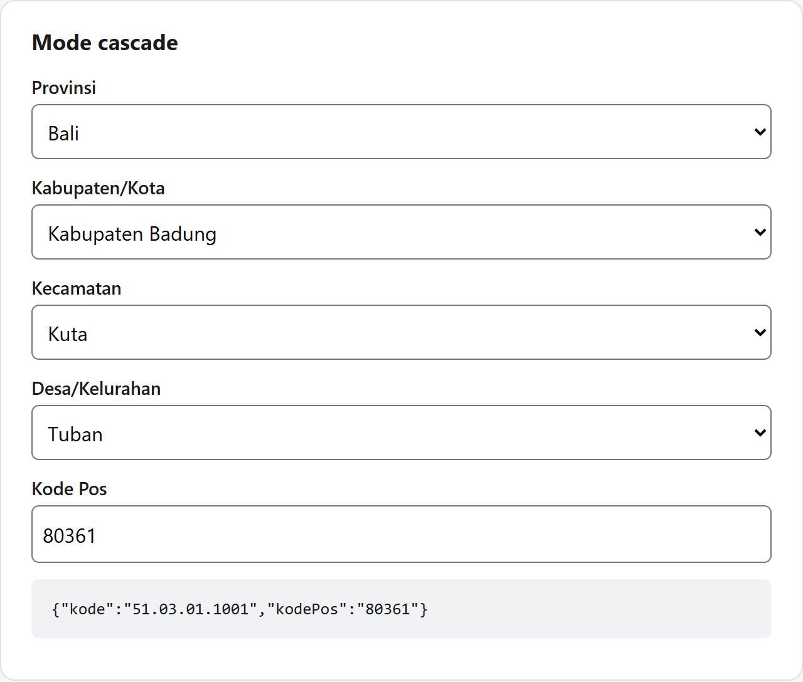

<!-- Draf untuk dev.to / Medium. Ganti tangkapan layar dengan GIF bila sempat. -->

Hampir setiap aplikasi di Indonesia punya form alamat: toko online, pendaftaran sekolah, aplikasi HR, ekspedisi. Biasanya caranya salah satu dari ini:

- impor dump SQL wilayah yang entah tahun berapa,
- memanggil API wilayah gratis yang kadang mati,
- atau menyuruh pengguna mengetik alamat bebas, lalu menyesal saat datanya mau diolah.

Masalahnya, kode wilayah **berubah**. Sejak 2022 Indonesia punya provinsi-provinsi baru di Papua, dan Kepmendagri No. 300.2.2-2430 Tahun 2025 kembali memindahkan dan mengganti nama sejumlah desa. Data lama berarti alamat yang salah.

Di artikel ini kita membuat dropdown alamat lengkap (provinsi → kabupaten/kota → kecamatan → desa/kelurahan, plus kode pos) dengan **[nusawilayah](https://github.com/cuikww/nusawilayah)**, library open source (MIT) yang memakai data Kepmendagri 2025:

- 38 provinsi, 514 kabupaten/kota, 7.285 kecamatan, 83.762 desa/kelurahan
- sekitar 5 KB JavaScript (gzip), data dimuat per langkah (< 1 KB) dari CDN
- bisa cari langsung: ketik `seminyak kuta` atau kode pos `80361`
- aksesibel (diuji axe, WCAG 2.1 AA), tanpa server tambahan



Coba dulu di **[playground](https://cuikww.github.io/nusawilayah/)**.

## 1. React / Next.js: satu komponen

```sh
npm install @nusawilayah/react
```

```tsx
'use client'
import { WilayahPicker } from '@nusawilayah/react'
import '@nusawilayah/react/style.css' // opsional: tema bawaan

export function AlamatForm() {
  return <WilayahPicker onChange={(alamat) => console.log(alamat)} />
}
```

Selesai. Empat dropdown bertingkat langsung jalan, datanya diambil dari jsDelivr. Setiap kali pengguna memilih, `onChange` menerima objek seperti ini:

```json
{
  "provinsi":  { "kode": "51", "nama": "Bali" },
  "kabupaten": { "kode": "51.03", "nama": "Kabupaten Badung", "tipe": "kabupaten" },
  "kecamatan": { "kode": "51.03.01", "nama": "Kuta" },
  "desa":      { "kode": "51.03.01.1001", "nama": "Tuban", "tipe": "kelurahan", "kodePos": ["80361"] },
  "kodePos": "80361"
}
```

**Simpan `alamat.desa.kode` saja** (misalnya `51.03.01.1001`). Dari satu kode itu seluruh alamat bisa dibangun ulang, termasuk saat form edit dibuka:

```tsx
<WilayahPicker defaultValue={user.kodeWilayah} onChange={setAlamat} />
```

### Mode pencarian

Pengguna HP lebih suka mengetik daripada membuka empat dropdown:

```tsx
<WilayahPicker mode="search" onChange={setAlamat} />
```

Ketik `denpasar sel`, `seminyak kuta`, kode pos `80361`, atau bahkan nama lama sebuah desa: hasilnya muncul tanpa server.

### Dengan React Hook Form

```tsx
<Controller
  name="alamat"
  control={control}
  rules={{ validate: (a) => !!a?.desa || 'Pilih desa/kelurahan' }}
  render={({ field }) => <WilayahPicker {...field} />}
/>
```

## 2. Laravel (atau backend apa pun): form biasa

Picker bisa mengisi `<input type="hidden">` untuk form HTML biasa, jadi cocok untuk Laravel + Inertia, atau halaman Blade yang memuat satu komponen React:

```tsx
<form method="post" action="/alamat">
  <WilayahPicker name="wilayah" required />
  <button>Simpan</button>
</form>
```

Server menerima dua field: `wilayah=51.03.01.1001` dan `wilayah_kodepos=80361`.

Untuk validasi di server, impor datanya sekali ke database. Paket `@nusawilayah/data` menyediakan **CSV** dan **SQLite** siap pakai:

```sh
curl -LO https://cdn.jsdelivr.net/npm/@nusawilayah/data@2025.2/export/csv/desa.csv
```

```sql
-- MySQL
CREATE TABLE desa (kode VARCHAR(13) PRIMARY KEY, induk VARCHAR(8), nama VARCHAR(100), tipe VARCHAR(16), kode_pos VARCHAR(5));
LOAD DATA LOCAL INFILE 'desa.csv' INTO TABLE desa
  FIELDS TERMINATED BY ',' OPTIONALLY ENCLOSED BY '"' IGNORE 1 LINES;
```

Lalu di controller:

```php
$data = $request->validate([
    'wilayah' => ['required', 'exists:desa,kode'],
    'wilayah_kodepos' => ['nullable', 'digits:5'],
]);
```

Tersedia juga `provinsi.csv`, `kabupaten.csv` dan `kecamatan.csv` dengan kolom `induk`, jadi relasi bertingkat tinggal di-JOIN. Pengguna Flutter, Python atau Go bisa langsung memakai `nusawilayah.sqlite`.

## 3. Data lama? Ada `migrate()`

Kalau database Anda sudah berisi kode dari Kepmendagri sebelumnya, sebagian desa mungkin sudah pindah kecamatan atau ganti nama. Paket `@nusawilayah/core` bisa mengeceknya:

```ts
import { createWilayah } from '@nusawilayah/core'

const w = createWilayah()
await w.migrate('72.01.09.2012')
// { status: 'moved', kode: '72.01.24.2007', namaLama: 'Tohitisari', alamat: { ... } }
```

Statusnya `unchanged`, `renamed`, `moved`, `removed` atau `unknown`, jadi Anda bisa memperbarui data lama secara otomatis dan hanya meninjau sisanya.

## 4. Tips produksi

- **Next.js App Router:** muat provinsi di server component lalu kirim lewat `initialProvinsi`, supaya dropdown pertama sudah ada di HTML.
- **Offline / kunjungan ulang:** `createWilayah({ cache: 'indexeddb' })` menyimpan data 7 hari di browser.
- **Tanpa CDN:** `npx nusawilayah copy public/wilayah` menyalin data ke folder Anda sendiri.
- **Kode pos** bersifat best-effort, jadi kolomnya tetap bisa diedit pengguna.

## Penutup

nusawilayah open source dan masih aktif dikembangkan. Data diperbarui otomatis setiap bulan, dan peta interaktif per provinsi/kabupaten/kecamatan sedang disiapkan.

- GitHub: https://github.com/cuikww/nusawilayah (⭐ sangat membantu)
- npm: [`@nusawilayah/react`](https://www.npmjs.com/package/@nusawilayah/react), [`@nusawilayah/core`](https://www.npmjs.com/package/@nusawilayah/core), [`@nusawilayah/data`](https://www.npmjs.com/package/@nusawilayah/data)

Menemukan nama desa yang salah atau butuh fitur? Buka issue, kontribusi sangat diterima.
