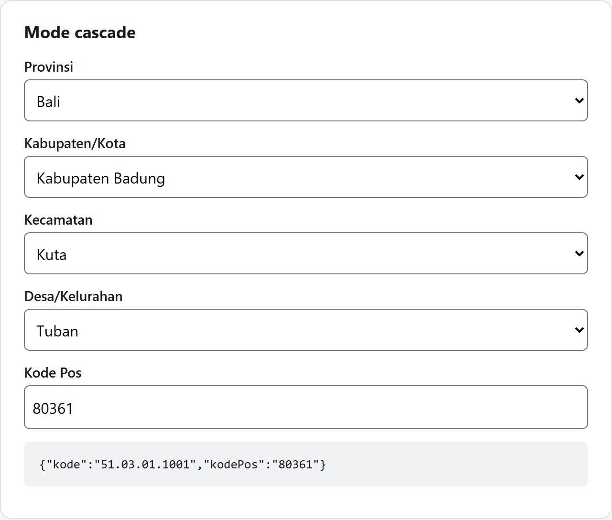

# @nusawilayah/react

Indonesian region picker for React: provinsi → kabupaten/kota → kecamatan → desa/kelurahan, plus postal code. Uses the official **Kepmendagri No. 300.2.2-2430 Tahun 2025** data (38 provinces, 514 regencies/cities, 7,285 districts, 83,762 villages). About 3 KB gzipped; the data loads on demand from a CDN.



```sh
npm install @nusawilayah/react
```

```tsx
import { WilayahPicker } from '@nusawilayah/react'

// four cascading dropdowns
<WilayahPicker onChange={(alamat) => save(alamat)} />

// one search box: "denpasar sel", "seminyak kuta", the postal code "80361" or a former name
<WilayahPicker mode="search" onChange={(alamat) => save(alamat)} />
```

`onChange` receives an `Alamat` (address):

```json
{
  "provinsi":  { "kode": "51", "nama": "Bali", "level": "provinsi" },
  "kabupaten": { "kode": "51.03", "nama": "Kabupaten Badung", "level": "kabupaten", "induk": "51", "tipe": "kabupaten" },
  "kecamatan": { "kode": "51.03.01", "nama": "Kuta", "level": "kecamatan", "induk": "51.03" },
  "desa":      { "kode": "51.03.01.1001", "nama": "Tuban", "level": "desa", "induk": "51.03.01", "tipe": "kelurahan", "kodePos": ["80361"] },
  "kodePos": "80361"
}
```

Store `alamat.desa.kode`; `defaultValue="51.03.01.1001"` restores the whole picker from it.

## Props

| Prop | Description |
| --- | --- |
| `mode` | `'cascade'` (default) or `'search'` |
| `levels` | 1 (provinsi) to 4 (desa, default) |
| `onChange` | Called with the `Alamat` on every change |
| `defaultValue` / `value` | Saved kode for edit forms, e.g. `'51.03.01.1001'`; `value` also accepts an `Alamat`, `null` clears |
| `name` | Hidden inputs for HTML forms: `{name}` = deepest kode, `{name}_kodepos` = postal code |
| `provinsi` | Restrict the provinces, e.g. `['51', '52']` |
| `required`, `disabled`, `placeholder` | As on native inputs |
| `labels` | Indonesian by default; pass `labelsEn` for English |
| `components={{ Field }}` | Replace the dropdown with your own UI component (shadcn/ui, MUI) |
| `client` | Your own `@nusawilayah/core` client (self-hosted data, custom fetcher, IndexedDB cache) |
| `initialProvinsi` | Provinsi loaded by a server component, so the first HTML has them |

## React Hook Form

```tsx
<Controller name="alamat" control={control} render={({ field }) => <WilayahPicker {...field} />} />
```

## Headless hook

```tsx
const { levels, select, setKode, retry, alamat } = useWilayah({ defaultValue: '51.03.01.1001' })
```

## Styling and accessibility

Unstyled by default. Import the optional theme with `import '@nusawilayah/react/style.css'` (customise it with `--nw-*` CSS variables), or style with `className` and the `data-nw-field`, `data-nw-error`, `data-nw-active` attributes. The postal code field is editable, because postal codes are best-effort. Dropdowns are native `<select>` elements and search mode is an ARIA 1.2 combobox, tested with axe (WCAG 2.1 AA).

## Data

By default the data loads from jsDelivr (`@nusawilayah/data`), under 1 KB per step. To self-host, run `npx nusawilayah copy public/wilayah` (with `@nusawilayah/data` installed) and pass `client={createWilayah({ baseUrl: '/wilayah' })}`. Add `cache: 'indexeddb'` to keep the data for repeat visits.

Tested with React 18 and 19, Vite and the Next.js App Router. Marked `"use client"`; pass `initialProvinsi` from a server component to render the provinsi on the server.

Full documentation and recipes: https://github.com/cuikww/nusawilayah · MIT License
